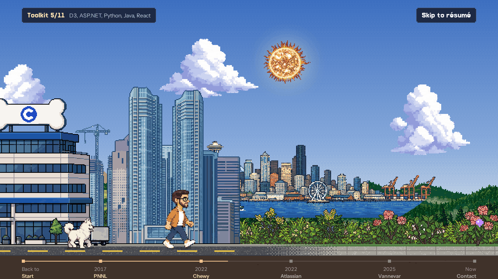
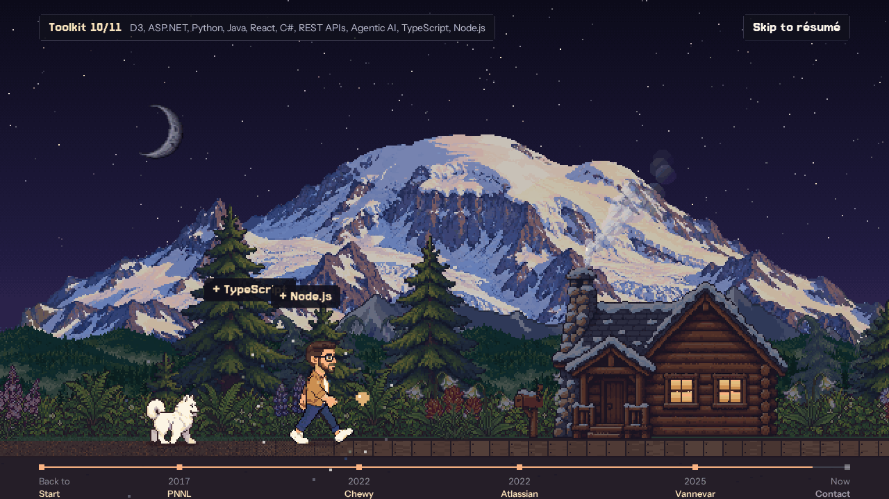
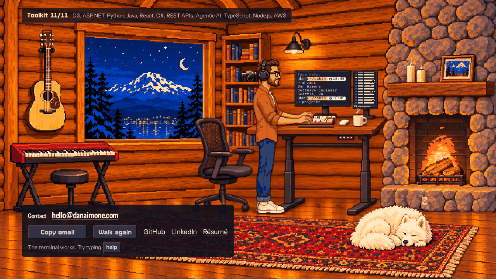

# danaimone.com

[](https://github.com/danaimone/danaimone.com/actions/workflows/ci.yml)

<p>
  
  
  
</p>

My personal site, live at https://danaimone.com. The top of the page is a scroll-driven pixel-art career walk: my Samoyed, Mishka, and I walk through Washington from a research lab (PNNL, 2017) past Chewy and Atlassian to Vannevar, with the Seattle skyline in the distance. The sky moves from dawn to night, Mount Rainier rises for the final reveal, and the walk ends inside a cabin with contact details. Below the walk is a résumé in Catppuccin Mocha, built from the same data as the downloadable PDF.

Built with Bun, Astro 7, Svelte 5, TypeScript, and canvas. The page is static HTML. The walk is one island: a framework-free game engine and a small Svelte overlay. UI text is Instrument Sans, with Jersey 15 for headings and buttons, sized in multiples of 7.5 px where it can be, so its pixels land on a 2x screen's; both are self-hosted. Characters, landmarks, scenery, icons, and the title logo are pixel-art sprites in `public/game/`. The sky and the era-by-era path are drawn in code.

### Art pipeline

The art was generated, then cut, cleaned and assembled by the scripts here. Raw generations are not committed; the prompts that were used with GPT Image (via Codex) are in `scripts/art-prompts/`. The cabin is built differently from the walk: each layout is one scene painted from scratch on a 4 px art grid (`cabin-wide.txt`, then `cabin-hands.txt` for the hands, then `cabin-tall.txt` to repaint the same room for phones). The desk group was then repainted as a walnut sit-stand desk with me standing at it (`cabin-desk.txt`, and `cabin-desk-tall.txt` for phones), and only that group was laid back onto each painting. The wide repaint came back with a soft face, so the head from the seated painting, which has hard outlines, was laid over it. `scripts/build-cabin.py` uses each painting as painted, with nothing pasted on (it redraws one thing, the keyboard's grey front strip, as the walnut wrist rest my keyboard has), measures the hearth for the fire the page simulates, and draws Mishka's breathing to fit it. The typing frames are painted too: `cabin-typing.txt` is run on a 16x close-up of the hands, once per finger pose, and only the finger pixels that changed are kept, with `room-layouts.json` as the manifest. The monitors are generated as flat key colors, so the masks come straight from the art. After any art build, run `python3 scripts/pack-art.py public/game`: it stores each image as an indexed PNG when that is pixel-identical and smaller, which roughly halves the art.

The walk's sprites came from two tools. PixelLab drew the ones that need a consistent character or a repeating tile: my character, Mishka, the plants, trees, clouds, skylines, Rainier, the hills, and most buildings. `scripts/assemble-sprites.py` and `scripts/assemble-scenery.py` cut and join those into the sheets in `public/game/`. The rest came from GPT Image and were cleaned with `scripts/pixelize.py`, which keys out the background, finds the art's block size, samples one colour per block, and limits the palette. `scripts/asset-lights.py` finds a building's window glass and lights a share of the panes for the night layer.

```sh
python3 scripts/assemble-sprites.py frames_dir mishka-base.png public/game
python3 scripts/assemble-scenery.py pixellab_dir public/game
python3 scripts/pixelize.py raw/sign.png public/game/sign.png --height 50 --colors 32
python3 scripts/pack-art.py public/game
```

## Development

Use [Bun](https://bun.sh). Install the locked dependencies:

```sh
bun install
bun run dev
```

The site runs at http://localhost:4321.

## Validation

```sh
bun run typecheck
bun run build
bun test
bun run preview
```

CI runs the first three on every push. Some tests read `dist/`, so build first.

Before publishing, walk the whole page at desktop and phone widths. Check the arrow keys, Space and tap to jump, the timeline teleports and Back to Start, the Rainier reveal, the cabin finale forward and back, the pixel dissolve on section links, reduced motion, and the PDF link. Open the browser console and confirm there are no Content Security Policy violations.

## Production deployment

The site is static: any web server can serve `dist/`. In production nginx serves it behind a reverse proxy.

1. Copy `resume/private.example.mjs` to `resume/private.mjs`. That file holds the phone number for private PDFs and stays out of git.
2. Run `bun run resume` on a machine with the licensed fonts. `public/resume.pdf` is committed output and has no phone number.
3. Run `bun run build`.
4. Copy `dist/` to the web server's root, replacing the old copy in one move.
5. Check the page, `/resume.pdf`, and the security headers through https://danaimone.com.

Pushing to `main` does not deploy.

## Security

- A strict Content Security Policy is generated at build time, with hashes for inline scripts and styles. Set dynamic styles through the CSSOM, because `style` attributes are blocked.
- The page makes no third-party requests. Fonts and images are served from the same origin.
- The web server allows only GET and HEAD, blocks dotfiles, and sends the usual hardening headers, HSTS among them.
- HTML, the PDF, and images send `Cache-Control: no-cache`, so browsers revalidate. Hashed `_astro` files are cached for a year.

## Structure

- `src/data/resume.ts`: the résumé and contact links. The walk, the page, and the PDF all read it. Edit content here.
- `resume/`: tailored versions (`versions/example.ts` shows the shape). The fact bank, versions written for one employer, and the private details stay out of the repository. `bun run resume` builds the PDFs, and `bun run resume <version>` builds a tailored one. PDFs use licensed fonts from the folder named in `resume/private.mjs` or by `RESUME_FONTS` and fall back to Jost and Source Serif 4 when they are missing. The fonts stay out of git.
- `src/components/game/track.ts`: converts between scroll, world position, walk progress, and the finale.
- `src/components/game/simulation.ts`: the rules of the walk, with no browser: following, sprinting, jumps, gems, zones, teleport. Input and effects are plain data, so `bun test` covers it.
- `src/components/game/world.ts`: career stops, landmarks, and gems. To add a job, add it to the résumé and give it a place here; the compiler requires it.
- `src/components/game/assets.ts`: loads the art by name. If any image fails, the walk becomes a static hero and the résumé still works.
- `src/components/game/sheets.ts`: the frame size and count of each sprite sheet.
- `src/data/projects.ts`: the projects listed under the résumé.
- `src/components/game/room-scene.ts`: the cabin's live scene: the fire (simulated in `fire.ts`), hand frames, candles, steam, Mishka, and window lights.
- `src/components/game/room-screens.ts`: the two monitors, the Rex terminal and Neovim showing `simulation.ts`. They are drawn on their own canvases at the display's resolution, in Departure Mono (SIL Open Font License, `src/fonts/`), sized to the font's 11 px grid where it fits. A monitor too small for readable type shows a minimap of the code instead.
- `src/components/game/terminal.ts`: the toy terminal on the monitor, styled after my own shell. Its replies are canned; a few commands act on the page (`resume`, `projects`, `open resume.pdf`, `stoke`, `doom`).
- `src/components/game/engine.ts`: the conductor. It feeds the simulation scroll and keys, turns its effects into page events, and decides the order of each frame. It draws nothing itself.
- `src/components/game/surface.ts`: the contract every canvas of the walk implements (`resize`, `paint`, `cut`), and the layout they share. `sky.ts`, `parallax.ts`, `plane.ts`, and `actors.ts` each own one canvas, or one set that moves together: its pixels, size, and transform. To add a canvas, write one surface and add it to the list in `engine.ts`.
- `src/components/game/wipe.ts` and `room-view.ts`: the iris from the cabin door onto the room, and where the room sits and how much of it a frame repaints. `wipe.plan()` says whether a frame is covered by the room, only needs the hole cut wider, or must repaint the walk.
- `src/components/game/finger.ts`, `keys.ts`, `page-activity.ts`, `particles.ts`, `toast-layer.ts`, `doom-launcher.ts`: touch, keyboard, what the page is doing around the walk, sparks and smoke, toast positions, and loading Doom on demand.
- `scripts/walk-frames.mjs`: captures the walk frame by frame under a fake clock and seeded randomness, at four screen sizes, and compares the result with an earlier capture. Run it before and after any change that should not move a pixel.
- `src/components/game/CareerWalk.svelte`: the overlay: intro, cards, toolkit, toasts, timeline.
- `src/components/game/art.ts`: sky palettes and dithering, the sun, smoke, tiled scenery, soil, gems.
- `src/components/game/path.ts`: the ground under the walk, stretch by stretch: its texture, what grows beside it, and where the trees stand.
- `src/components/game/doom.ts`: Doom on the cabin's monitor, loaded only when asked for (see `public/doom/` for its licences and build script).
- `src/components/game/steady-clock.ts`, `probe.ts`: frame and touch times with the browser's rounding removed, and the `?probe` overlay that measures a swipe on a real phone.
- `public/game/`: sprites, scenery layers, building `-lights` layers, company logos, and icons.
- `scripts/assemble-sprites.py`, `scripts/assemble-scenery.py`, `scripts/pixelize.py`, `scripts/asset-lights.py`, `scripts/build-cabin.py`, `scripts/pack-art.py`, `scripts/art-prompts/`: the art pipeline.
- `src/pages/index.astro`: page layout, metadata, the résumé sheet, About, and Contact.
- `src/styles/`: `base.css` holds the tokens, reset, pixel buttons and masthead; `walk.css` the walk's overlays, cards and timeline; `page.css` the résumé sheet, About, Contact and footer. Each file keeps its own narrow-screen rules.
- `src/scripts/pixel-wipe.ts`: the pixel dissolve on in-page links.

The walk renders at a small logical resolution (about 480 × 300 on a laptop), scaled by a whole number of device pixels so every art pixel stays square and sharp. The cabin interior is a separate canvas at art resolution, for the same reason. Physics run at a fixed 60 steps per second on any display. See `GLOSSARY.md` for the terms used in the code. The loop stops when the walk is off screen. Skill gems are placed only where the verified history supports them; TypeScript, Node.js, and AWS sit at the cabin because they describe current day-to-day work, not a specific employer.

## Licence

The code is MIT licensed. The artwork and the résumé text are not: they depict me and my dog, and are all rights reserved. Doom and the fonts carry their own licences. See `LICENSE` and `NOTICE.md`.
